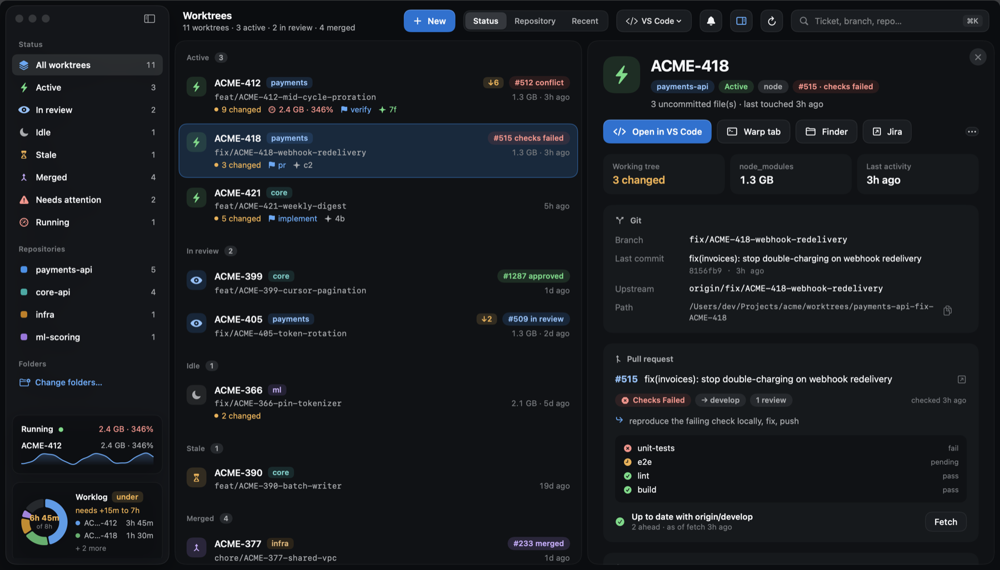
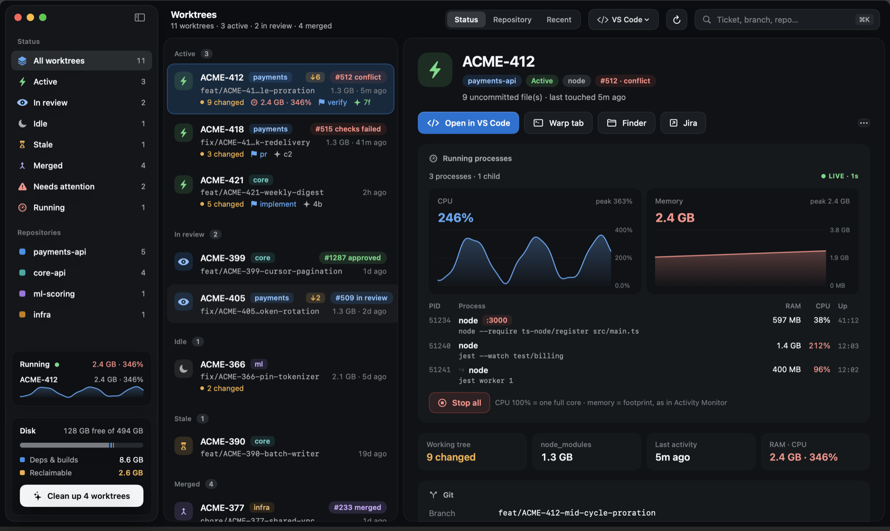
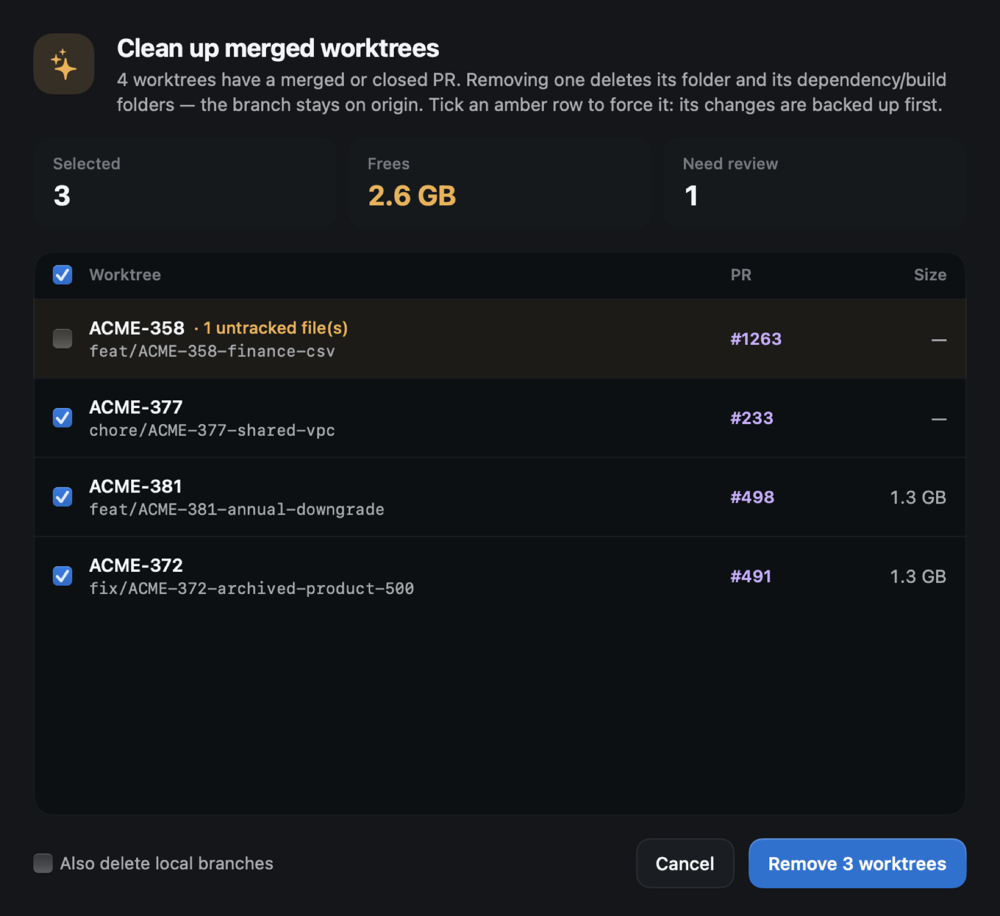
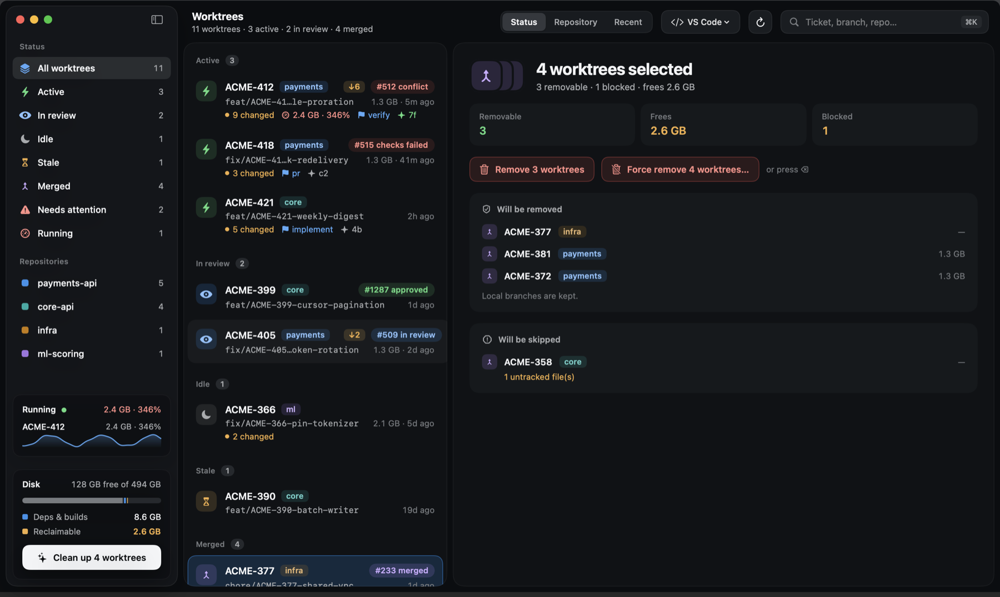

# git-worktree-tracker

**Worktrees.app** is a native macOS app for people who keep many git worktrees open across
several repos at once. Typical cases are one worktree per ticket, or an AI agent working in
parallel worktrees.

It answers four questions:

- What is each worktree doing?
- What does it cost in disk, CPU and memory?
- What does its PR need from you?
- Which worktrees can you delete without losing work?



> The screenshots use the bundled demo data (`docs/demo-fixture.json`); every repo and ticket
> in them is made up.

## Features

### See every worktree at a glance

- **Grouped by state.** Each worktree is grouped as *active*, *in review*, *idle*, *stale* or
  *merged*. This comes from uncommitted changes, the open PR, running processes and recent
  activity. You can also group by repository or by recent activity.
- **One row per worktree.** Each row shows the ticket, repo, branch, size, changed files, the
  Claude Code session working on it, and a PR chip: *conflict*, *checks failed*, *approved*,
  *in review* or *merged*.
- **Behind the base.** `↓6` means the worktree is 6 commits behind its PR base. The count uses
  your local refs, so it is as fresh as your last fetch, and **Fetch** updates it.
- **Needs attention.** This filter collects every PR with failing checks, a conflict or
  requested changes.
- **Workspaces.** Keep separate sets of folders, for example *Work* and *Personal*, each with
  its own Jira URL, ticket pattern and repo labels. Switch between them in the sidebar, or
  view all of them together.
- **Finds every kind of repo.** It finds normal checkouts, bare repos (`repo.git/`, the
  `.bare/` layout) and repos whose main checkout sits outside your folders but which have a
  worktree inside them. Repos are searched up to three levels deep.
- **Any stack.** Go, Python, Node, Rust, JVM, Swift, Ruby, PHP, Elixir and Terraform are
  detected from their marker files.

### Start a ticket in one step

**+ New** (⌘N) creates a worktree for a ticket in a sibling `worktrees/` folder, on a new branch.
The branch defaults to `feat/ABC-123` and you can edit it.

1. **Fresh base.** Runs `git fetch origin <base>` first. If the fetch fails, nothing is
   created, so a worktree never starts from a stale base.
2. **Verified.** Records the base SHA and checks that the new HEAD matches it.
3. **Env files.** Copies `.env*.example` to `.env*`.
4. **Dependencies.** Clones `node_modules` from the main checkout with APFS copy-on-write
   (seconds, and no extra disk) when the lockfiles are identical. When they differ, it tells
   you to run your install.

### Notifications

The app posts a macOS banner when a PR newly has **failing checks**, a **conflict** or
**requested changes**, or when it gets **approved** or **merged**. Click the banner to open
that worktree. PR states are checked every two minutes and persisted, so restarting the app
never re-alerts. The bell in the toolbar turns this on or off.

### PR and CI without opening GitHub

The detail panel lists every CI check, linked to its log, plus the review count and a hint for
the next step. Status comes from `gh` and is cached for two minutes.

### Live CPU and memory per worktree



- **Which processes count.** Every process whose working directory is inside a worktree, and
  all of their children: dev servers, test watchers, `go test`, `pytest`, workers.
- **How it is measured.** Sampled every second through `libproc`, the same source Activity
  Monitor uses. CPU is instantaneous, and 100% means one full core. Memory is the physical
  footprint. You get a 2-minute chart, a per-process table with listening ports, and
  **Stop all**.
- **Running.** The sidebar card shows what is running right now, with a sparkline per
  worktree.

### This Mac and today's worklog

The sidebar shows the whole machine, refreshed every second: CPU, memory used (as Activity
Monitor counts it) and network in/out, each with a sparkline, next to the disk bar.

With a companion project that provides `scripts/worklog_day.py`, the sidebar also shows a
**worklog donut**: today's logged time per ticket against an 8h target and a 7–9h band. It is
coloured *under*, *balanced* or *over*. Click it for the list of entries.

### Jump to the right terminal tab

**Warp tab** focuses the pane that is already working on the worktree, using Warp's own
`warp://session/<uuid>`. The pane is found in this order:

1. the Claude Code session whose recent tool calls touched the worktree,
2. a process running inside the worktree,
3. a shell whose working directory is inside the worktree.

If none matches, a new tab opens in the worktree. Without Warp installed, the app opens
Terminal instead.

The **Open in** button uses whichever editors are installed: VS Code, Cursor, the JetBrains
IDEs, Zed, Sublime Text or Xcode.

### Clean up without losing work



- **Safe by default.** A removal is refused when the worktree has uncommitted or untracked
  files, unpushed commits, running processes, a lock, or an active `/dev` run. The reason is
  always shown.
- **Fast.** Git-ignored dependency and build folders are moved aside first, so removal takes
  seconds instead of minutes, and they are deleted in the background. This covers
  `node_modules`, `.venv`, `target`, `.gradle`, `Pods` and the like. A folder git tracks,
  such as a committed Go `vendor/`, is never touched.
- **Multi-select.** ⌘-click or ⇧-click several worktrees, then press ⌫.
- **Force remove.** Saves `changes.patch` (tracked changes) and a copy of every untracked file
  to `~/Library/Application Support/git-worktree-tracker/backups/`, with restore steps. It is refused for anything changed in the last 24
  hours or with processes still running.
- **Branches.** Local branches are kept. *Also delete local branches* removes only branches
  git agrees are merged.



## Install

Requires macOS 14 or later (Apple Silicon or Intel) and the Xcode Command Line Tools, which
provide git and Python 3 (`xcode-select --install`). The [GitHub CLI](https://cli.github.com)
is optional and enables PR status.

**Homebrew**

```bash
brew install --cask duynguyentho/tap/git-worktree-tracker
```

**One-line installer.** It downloads the latest release, verifies its checksum and installs
into `~/Applications`:

```bash
curl -fsSL https://raw.githubusercontent.com/duynguyentho/git-worktree-tracker/main/install.sh | sh
```

**From source**

```bash
git clone https://github.com/duynguyentho/git-worktree-tracker
cd git-worktree-tracker
app/build.sh            # builds with swiftc, installs ~/Applications/Worktrees.app, launches it
app/build.sh --login    # also adds it to Login Items
```

On first launch the app proposes the code folders it found (`~/Projects`, `~/Developer`,
`~/code`, …), or you can pick your own. Repos up to three levels deep are found, and their
worktrees are discovered wherever they live. You can change the folders later from the
sidebar.

> The app is ad-hoc signed but **not notarized**. The Homebrew cask and the installer clear
> the quarantine flag for you. If you download the zip by hand, right-click → **Open** the
> first time, or run `xattr -dr com.apple.quarantine Worktrees.app`.

## Configuration

Everything is optional and set from the app: the welcome sheet, **Change folders…**, and the
workspace menu (**New**, **Rename**, **Remove**). The settings live outside the repo, in
`~/.config/git-worktree-tracker/config.json`:

```json
{
  "workspaces": [
    {
      "name": "Work",
      "bases": ["~/work/acme"],
      "jira_url": "https://acme.atlassian.net",
      "ticket_regex": "\\bACME-\\d+\\b",
      "repos": { "payments-api": { "label": "payments", "hue": 250 } },
      "assistant": "~/Projects/my-assistant"
    },
    { "name": "Personal", "bases": ["~/Projects", "~/Developer"] }
  ],
  "scan_depth": 3,
  "artifact_dirs": ["node_modules", ".venv", "target"]
}
```

| Key (per workspace) | Default | Purpose |
|-----|---------|---------|
| `name` | `Default` | Shown in the workspace switcher |
| `bases` | common code folders that exist | Folders searched for repos |
| `scan_depth` | `3` | How many folder levels below each base are searched (per workspace or top level) |
| `jira_url` | — | Shows the Jira buttons for this workspace's ticket keys |
| `ticket_regex` | `\b[A-Z][A-Z0-9]+-\d+\b` | How a ticket key is read from a branch or folder name |
| `repos` | name + derived colour | Short label and OKLCH hue per repo |
| `assistant` | — | Optional companion project that provides `/dev` run state and `scripts/pr_watch.py` for PR/CI status |

`artifact_dirs` (top level) lists the folders that are measured and moved aside on removal,
and only when git ignores them. The default covers `node_modules`, `.venv`, `venv`, `.tox`,
`vendor`, `target`, `build`, `dist`, `.next`, `.gradle`, `.build`, `Pods` and more. An older
flat config (top-level `bases` or `base`) still works, and is read as one workspace.

### How repos are found

Each base is walked up to `scan_depth` levels. Hidden folders and `node_modules`, `vendor`,
`target`, `dist`, `build` are skipped. A folder counts as:

- **a repo** when it has a `.git` directory, or when it is a bare repo (`HEAD`, `objects/`,
  `refs/`);
- **a worktree** when it has a `.git` file. Its `gitdir:` points back to the shared git dir,
  so the repo it belongs to is found even if that repo lives elsewhere.

The app does not search inside a repo once it has found one. For every repo it then asks git
for the full list with `git worktree list --porcelain`, so worktrees are shown wherever they
live on disk.

Environment variables override the file: `WT_BASE` (a single folder), `WT_ASSISTANT`,
`WT_DEV_RUNS`, `WT_PR_WATCH_DIR`, `WT_CACHE_PATH`, `WT_BACKUPS`, `WT_CONFIG`, `GH_BIN`.

| Data | Location |
|------|----------|
| Settings | `~/.config/git-worktree-tracker/config.json` |
| Cache (PR states, sizes) | `~/Library/Caches/git-worktree-tracker/` |
| Force-remove backups | `~/Library/Application Support/git-worktree-tracker/backups/` |

## Keyboard

| Keys | Action |
|------|--------|
| ⌘N | New worktree |
| ⌘K | Search worktrees |
| ↑ ↓ (⇧ to extend) | Move the selection |
| ⌘-click / ⇧-click / ⌘A | Multi-select |
| ↩ or double-click | Open in the editor |
| ⌫ or ⌘⌫ | Remove the selected worktrees |
| ⌘R | Refresh (re-fetch PR states) |
| ⌃⌘S | Toggle the sidebar |

## CLI

`scripts/wt.py` is the app's backend and works on its own:

```bash
python3 scripts/wt.py list [--json] [--sizes] [--refresh] [--offline]
python3 scripts/wt.py open <name|KEY> [--app webstorm|code|cursor|warp|finder]
python3 scripts/wt.py remove <name|KEY>... [--force] [--delete-branch] [--yes]
python3 scripts/wt.py prune [--yes]                  # every clean worktree whose PR is merged/closed
python3 scripts/wt.py procs [--with-sessions] [PATH...]
python3 scripts/wt.py kill <name|KEY> [--yes]        # SIGTERM processes running inside
python3 scripts/wt.py fetch <name|KEY>               # git fetch origin <PR base>
python3 scripts/wt.py create <repo> <branch> [--base develop] [--no-deps] [--json]
python3 scripts/wt.py repos                          # repos + candidate base branches (JSON)
python3 scripts/wt.py worklog                        # today's worklog via the companion project
python3 scripts/wt.py config [--workspace NAME] [--set-bases DIR...] [--rename NAME] [--remove-workspace NAME]
```

## Project layout

| Path | What |
|------|------|
| `app/WorktreeBar.swift` | The SwiftUI app: main window, menu bar extra, `libproc` sampler |
| `app/build.sh` | Builds `Worktrees.app` with `swiftc`. `--release` builds a universal, self-contained zip |
| `install.sh` | One-line installer from the latest GitHub release |
| `.github/workflows/release.yml` | Pushing a `v*` tag builds the universal app and publishes it to GitHub Releases |
| `scripts/wt.py` | Backend and CLI. Every read and every removal goes through it |
| `docs/demo-fixture.json` | Anonymised demo data used for the screenshots |

### Regenerating the screenshots

The app can render its own window to PNG without Screen Recording permission:

```bash
export WT_FIXTURE=docs/demo-fixture.json
APP=~/Applications/Worktrees.app/Contents/MacOS/Worktrees
$APP --snapshot docs/screenshots/overview.png --select fix-ACME-418 --delay 3
$APP --snapshot docs/screenshots/live-resources.png --select feat-ACME-412 --procs-first --delay 3
$APP --snapshot docs/screenshots/multi-select.png --select feat-ACME-381,fix-ACME-372,feat-ACME-358,chore-ACME-377 --delay 3
$APP --snapshot docs/screenshots/cleanup.png --cleanup --delay 3
```

Add `--light` for the light appearance.

## Limitations

- **Unattributed processes.** Editor and IDE processes, and Docker containers, run outside the
  worktree folder, so they are not counted.
- **CI depends on the repo.** CI checks appear only when the repo reports them to GitHub.
- **Claude session matching.** It reads the tail of each live session's transcript in
  `~/.claude`, which is a heuristic.
